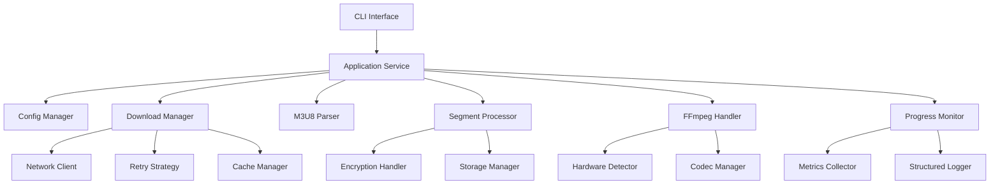

# 视频处理器优化设计文档

## 概述

本设计文档描述了对现有视频处理器项目的全面优化方案。优化重点包括架构重构、性能提升、错误处理增强、配置管理改进和监控系统完善。设计采用模块化架构，确保高内聚低耦合，同时保持向后兼容性。

## 架构设计

### 整体架构

系统采用分层架构模式，包含以下层次：

1. **表示层 (Presentation Layer)**: CLI接口和配置管理
2. **应用层 (Application Layer)**: 业务逻辑协调和工作流管理
3. **领域层 (Domain Layer)**: 核心业务逻辑和实体
4. **基础设施层 (Infrastructure Layer)**: 外部服务集成和数据持久化

### 核心组件



## 组件和接口

### 1. 配置管理器 (Config Manager)

```rust
pub trait ConfigManager {
    async fn load_config(&self) -> Result<Config>;
    async fn validate_config(&self, config: &Config) -> Result<()>;
    async fn reload_config(&self) -> Result<Config>;
    fn watch_config_changes(&self) -> impl Stream<Item = Config>;
}

pub struct Config {
    pub download: DownloadConfig,
    pub processing: ProcessingConfig,
    pub output: OutputConfig,
    pub monitoring: MonitoringConfig,
}
```

### 2. 下载管理器 (Download Manager)

```rust
pub trait DownloadManager {
    async fn download_segments(&self, urls: Vec<String>) -> Result<Vec<SegmentData>>;
    async fn set_concurrency(&self, level: usize);
    fn get_download_stats(&self) -> DownloadStats;
}

pub struct AdaptiveDownloadManager {
    concurrency_controller: Arc<ConcurrencyController>,
    retry_strategy: Arc<dyn RetryStrategy>,
    bandwidth_monitor: Arc<BandwidthMonitor>,
}
```

### 3. M3U8解析器 (M3U8 Parser)

```rust
pub trait M3U8Parser {
    async fn parse(&self, url: &str) -> Result<Playlist>;
    async fn resolve_segments(&self, playlist: &Playlist) -> Result<Vec<Segment>>;
    fn validate_playlist(&self, playlist: &Playlist) -> Result<()>;
}

pub struct Playlist {
    pub segments: Vec<Segment>,
    pub encryption: Option<EncryptionInfo>,
    pub metadata: PlaylistMetadata,
}
```

### 4. 片段处理器 (Segment Processor)

```rust
pub trait SegmentProcessor {
    async fn process_segment(&self, segment: &Segment) -> Result<ProcessedSegment>;
    async fn decrypt_if_needed(&self, data: &[u8], encryption: &EncryptionInfo) -> Result<Vec<u8>>;
}

pub struct ProcessedSegment {
    pub index: usize,
    pub data: Vec<u8>,
    pub metadata: SegmentMetadata,
}
```

### 5. FFmpeg处理器 (FFmpeg Handler)

```rust
pub trait FFmpegHandler {
    async fn start_process(&self, config: &ProcessingConfig) -> Result<FFmpegProcess>;
    async fn detect_hardware_acceleration(&self) -> Vec<HardwareAccelerator>;
    async fn optimize_encoding_params(&self, input_info: &InputInfo) -> EncodingParams;
}

pub struct FFmpegProcess {
    pub stdin: Box<dyn AsyncWrite + Send + Unpin>,
    pub process: Child,
    pub output_path: PathBuf,
}
```

## 数据模型

### 核心实体

```rust
#[derive(Debug, Clone)]
pub struct Segment {
    pub index: usize,
    pub url: String,
    pub duration: f64,
    pub encryption: Option<EncryptionInfo>,
}

#[derive(Debug, Clone)]
pub struct EncryptionInfo {
    pub method: EncryptionMethod,
    pub key_url: Option<String>,
    pub key_data: Option<Vec<u8>>,
    pub iv: Option<Vec<u8>>,
}

#[derive(Debug, Clone)]
pub struct DownloadStats {
    pub total_segments: usize,
    pub completed_segments: usize,
    pub failed_segments: usize,
    pub total_bytes: u64,
    pub download_speed: f64,
    pub estimated_time_remaining: Duration,
}
```

## 正确性属性

*属性是一个特征或行为，应该在系统的所有有效执行中保持为真——本质上是关于系统应该做什么的正式声明。属性作为人类可读规范和机器可验证正确性保证之间的桥梁。*

<function_calls>
<invoke name="prework">
<parameter name="featureName">video-processor-optimization

### 属性反思

在编写正确性属性之前，我需要审查所有在预工作中识别为可测试的属性，以消除冗余：

**冗余分析：**
- 属性2.1（自适应并发控制）和属性2.2（动态调整下载策略）可以合并为一个更全面的属性，因为并发控制是下载策略的一部分
- 属性5.1（实时进度更新）和属性2.5（下载统计和预估时间）有重叠，可以合并为一个关于进度监控准确性的属性
- 属性7.3（多种编码格式）和属性7.4（音频处理）可以合并为一个关于媒体格式支持的综合属性

**最终属性列表：**
经过反思，我将保留独特且有价值的属性，确保每个属性提供独特的验证价值。

### 正确性属性

Property 1: 模块接口一致性
*对于任何*实现的模块，该模块应该实现其对应的trait接口并提供所有必需的方法
**验证需求: 1.2**

Property 2: 依赖注入配置有效性
*对于任何*有效的依赖配置，系统应该能够正确初始化所有组件并建立依赖关系
**验证需求: 1.3**

Property 3: 自适应下载策略
*对于任何*网络条件变化，下载管理器应该根据带宽和延迟自动调整并发数和下载策略
**验证需求: 2.1, 2.2**

Property 4: 智能重试机制
*对于任何*下载失败场景，系统应该根据错误类型选择适当的重试策略，包括指数退避
**验证需求: 2.3**

Property 5: 断点续传一致性
*对于任何*中断的下载任务，系统应该能够从上次成功的位置继续下载，不重复已下载的数据
**验证需求: 2.4**

Property 6: 进度监控准确性
*对于任何*正在进行的任务，进度监控器应该提供准确的实时统计信息和合理的完成时间预估
**验证需求: 2.5, 5.1**

Property 7: 错误分类和恢复
*对于任何*网络错误，错误处理器应该正确分类错误类型并选择相应的恢复策略
**验证需求: 3.1**

Property 8: 解析错误诊断
*对于任何*无效的M3U8内容，解析器应该提供详细的错误诊断信息，包括错误位置和原因
**验证需求: 3.2**

Property 9: FFmpeg进程恢复
*对于任何*FFmpeg进程异常，处理器应该检测到异常并尝试重启或降级处理
**验证需求: 3.3**

Property 10: 磁盘空间管理
*对于任何*磁盘空间不足的情况，系统应该提前检测并采取清理或暂停措施，并且对于不存在的监控目录应该优雅处理
**验证需求: 3.4, 3.5**

Property 11: 状态持久化
*对于任何*致命错误，系统应该保存当前状态以支持后续恢复操作
**验证需求: 3.5**

Property 12: 多源配置加载
*对于任何*配置源（文件、环境变量、命令行），配置管理器应该能够正确加载和合并配置
**验证需求: 4.1**

Property 13: 配置验证完整性
*对于任何*配置参数，系统应该在启动时验证其有效性并拒绝无效配置
**验证需求: 4.2**

Property 14: 热重载配置
*对于任何*运行时配置修改，系统应该能够重新加载配置而不需要重启
**验证需求: 4.3**

Property 15: 配置优先级规则
*对于任何*配置冲突，系统应该按照明确的优先级规则解决冲突
**验证需求: 4.5**

Property 16: 结构化日志格式
*对于任何*日志记录，系统应该生成符合结构化格式的日志，包含必要的上下文信息
**验证需求: 5.2**

Property 17: 性能指标收集
*对于任何*运行中的任务，性能监控器应该收集关键指标并生成准确的报告
**验证需求: 5.3**

Property 18: 数据导出格式
*对于任何*监控数据导出请求，系统应该生成符合标准格式（JSON、CSV）的输出
**验证需求: 5.4**

Property 19: 阈值告警机制
*对于任何*设置的阈值，当指标超过阈值时系统应该触发相应的告警
**验证需求: 5.5**

Property 20: M3U8格式兼容性
*对于任何*有效的M3U8文件格式，解析器应该能够正确解析并提取片段信息
**验证需求: 7.1**

Property 21: 加密算法支持
*对于任何*支持的加密算法，加密处理器应该能够正确解密内容
**验证需求: 7.2**

Property 22: 媒体格式处理
*对于任何*支持的编码格式，FFmpeg处理器应该能够正确处理视频和音频内容
**验证需求: 7.3, 7.4**

Property 23: 字幕处理功能
*对于任何*字幕文件，系统应该能够正确下载、解析和嵌入字幕内容
**验证需求: 7.5**

## 错误处理

### 错误分类体系

```rust
#[derive(Debug, thiserror::Error)]
pub enum VideoProcessorError {
    #[error("网络错误: {0}")]
    Network(#[from] NetworkError),
    
    #[error("解析错误: {0}")]
    Parsing(#[from] ParsingError),
    
    #[error("处理错误: {0}")]
    Processing(#[from] ProcessingError),
    
    #[error("配置错误: {0}")]
    Configuration(#[from] ConfigError),
    
    #[error("系统错误: {0}")]
    System(#[from] SystemError),
}
```

### 恢复策略

1. **网络错误恢复**
   - 连接超时：指数退避重试
   - DNS解析失败：切换DNS服务器
   - 服务器错误：降级处理或跳过

2. **解析错误恢复**
   - 格式错误：尝试兼容性解析
   - 编码错误：自动检测编码
   - 结构错误：部分解析和警告

3. **处理错误恢复**
   - FFmpeg崩溃：重启进程
   - 内存不足：减少并发数
   - 磁盘满：清理临时文件

## 测试策略

### 双重测试方法

系统将采用单元测试和基于属性的测试相结合的方法：

**单元测试要求：**
- 单元测试验证具体示例、边界情况和错误条件
- 集成测试验证组件间的交互
- 单元测试有助于捕获具体的错误，但避免编写过多

**基于属性的测试要求：**
- 使用proptest库进行基于属性的测试
- 每个属性测试配置为运行最少100次迭代
- 每个基于属性的测试必须用注释明确引用设计文档中的正确性属性
- 使用格式：'**Feature: video-processor-optimization, Property {number}: {property_text}**'
- 每个正确性属性必须由单个基于属性的测试实现
- 编写智能生成器，合理约束输入空间

**测试覆盖要求：**
- 所有公共API必须有单元测试覆盖
- 所有正确性属性必须有对应的基于属性的测试
- 错误注入测试验证错误处理和恢复机制
- 并发安全测试验证线程安全性

### 性能测试

- 基准测试验证关键路径性能
- 负载测试验证系统在高并发下的表现
- 内存泄漏测试确保长时间运行的稳定性
- 网络条件模拟测试验证自适应行为

## 监控和可观测性

### 指标收集

```rust
pub struct Metrics {
    pub download_speed: Gauge,
    pub active_downloads: Gauge,
    pub error_rate: Counter,
    pub processing_time: Histogram,
    pub memory_usage: Gauge,
}
```

### 结构化日志

```rust
#[derive(Serialize)]
pub struct LogEntry {
    pub timestamp: DateTime<Utc>,
    pub level: LogLevel,
    pub module: String,
    pub message: String,
    pub context: HashMap<String, Value>,
    pub trace_id: Option<String>,
}
```

### 告警规则

- 下载失败率超过10%
- 内存使用率超过80%
- 磁盘空间低于1GB
- FFmpeg进程异常退出
- 网络延迟超过5秒

## 部署和运维

### 配置管理

支持多层配置优先级：
1. 命令行参数（最高优先级）
2. 环境变量
3. 配置文件
4. 默认值（最低优先级）

### 健康检查

```rust
pub struct HealthCheck {
    pub status: HealthStatus,
    pub components: HashMap<String, ComponentHealth>,
    pub timestamp: DateTime<Utc>,
}
```

### 优雅关闭

- 完成正在进行的下载
- 保存当前状态
- 清理临时文件
- 关闭所有连接